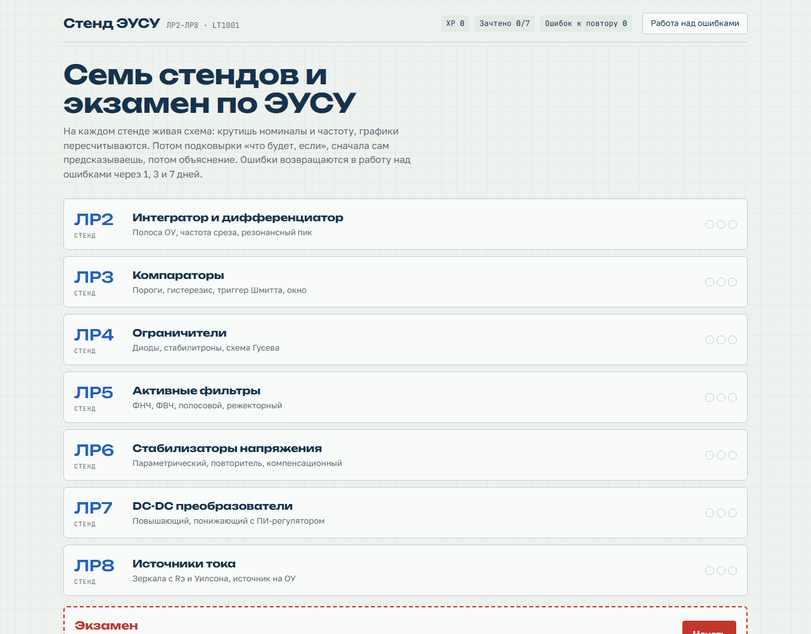
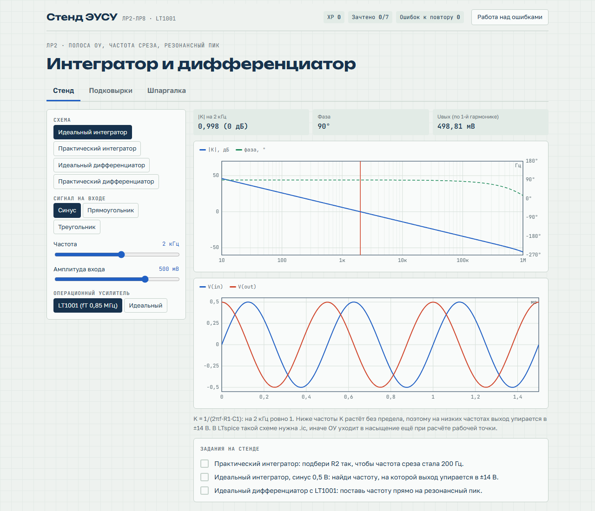
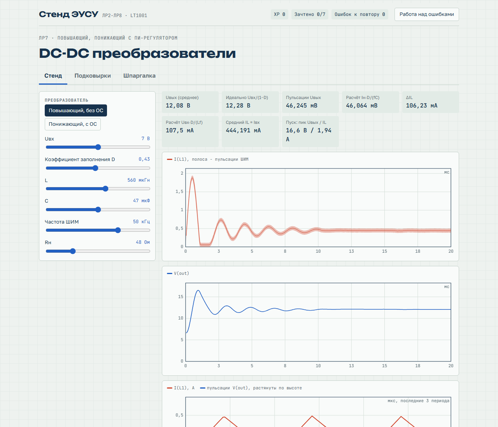
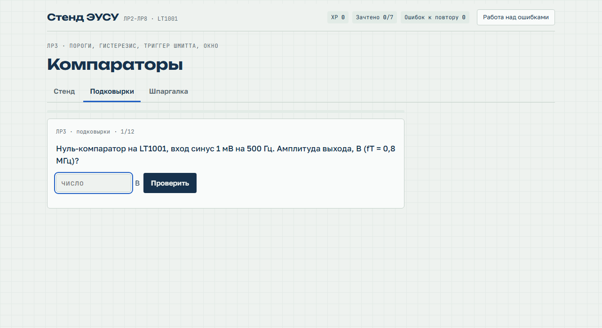

# Стенд ЭУСУ

Тренажёр по лабораторным работам курса «Электронные устройства систем управления», ИТМО.

Семь стендов (ЛР2-ЛР8) с живыми схемами на ОУ LT1001, вопросы «что будет, если», шпаргалки и экзамен.

Запуск локально: открыть `index.html` в браузере.
